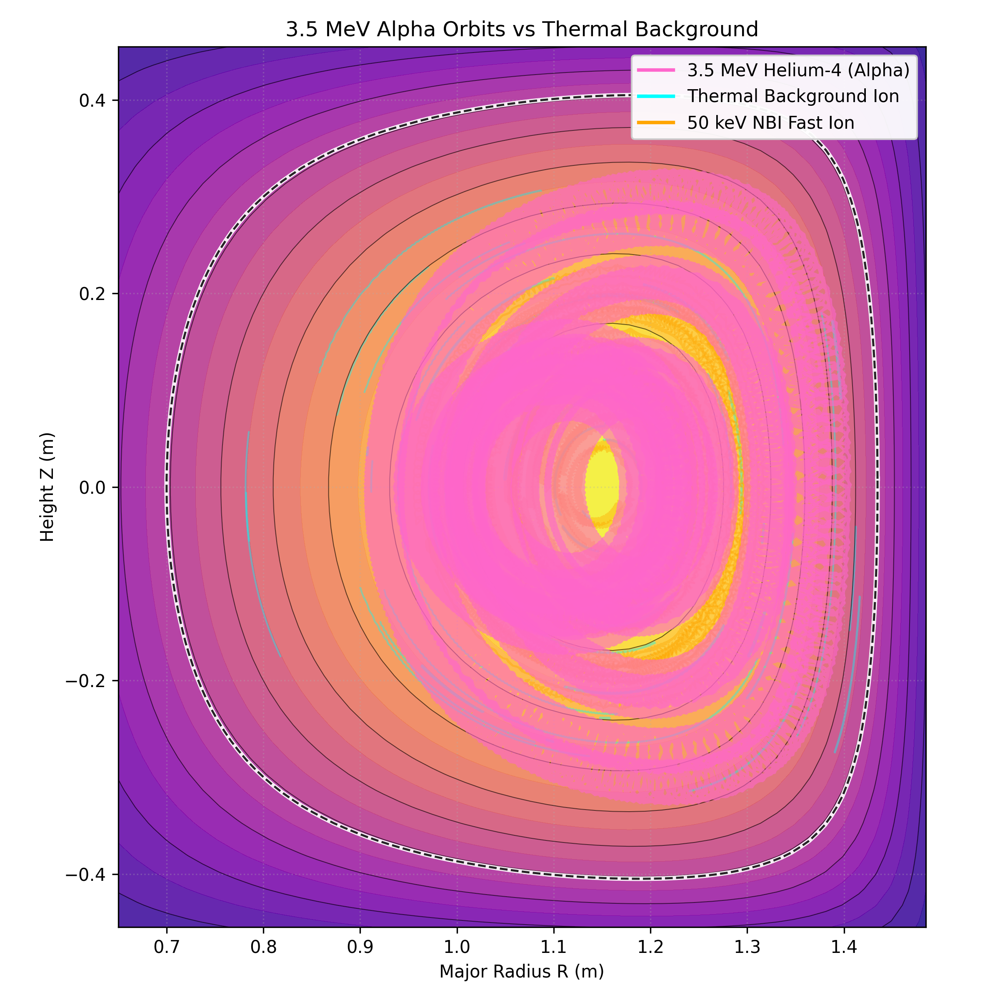

# Particle-In-Cell Tokamak Fusion Simulation

A particle-in-cell style simulation of ions in a magnetically confined tokamak plasma. It
solves a Grad–Shafranov equilibrium, pushes thermal deuterons, neutral-beam ions and 3.5 MeV
alphas through the resulting field with a Boris integrator, removes particles that cross the
last closed flux surface, and writes 11 diagnostic plots. Read *Scope and limitations* before
drawing conclusions from the numbers: several parts are prescribed rather than computed.

Written in Python with Numba JIT and PyTorch backends.


---

## How it works

Each timestep of the reactor run does the following, in this order:

1. **Sources.** Neutral beam injection adds 50 keV ions on a decaying schedule. One 3.5 MeV alpha is injected every 4 steps on a fixed schedule.
2. **Electric field.** At step 0 and every 100 steps, the thermal-ion density and pressure profiles are measured on flux surfaces and the radial electric field is rebuilt from ion force balance on a 50×50 (R, Z) grid.
3. **Field lookup.** Each particle gets the local electric field from that grid and a magnetic field made of the toroidal B0·R0/R field, the poloidal field derived from the Grad–Shafranov flux, and a prescribed tearing-mode perturbation.
4. **Push.** The Boris integrator advances every particle's velocity and position under the Lorentz force. Alphas take 10 sub-steps per global step, with the field re-evaluated at each sub-step.
5. **Collisions.** At a fixed rate, a bulk ion's velocity direction is re-drawn isotropically with its speed unchanged.
6. **Losses.** Particles that cross the last closed flux surface are counted and removed.
7. **Alpha slowing-down.** Alphas lose a fixed fraction of their energy per step, and that energy is added to the bulk ions.
8. **Pellet trigger.** Once the prescribed tearing-mode amplitude passes a preset threshold, a scripted radiative drain starts scaling the bulk velocities down.
9. **Diagnostics.** Confined count, stored energy, bulk temperature and the Lawson triple product are recorded each step. The flux-surface profiles, ion density map, phase-space map and fusion power map are computed once from the final state and plotted.

## Physics and features

**Magnetic equilibrium.** `mhd_equilibrium.py` solves the Grad–Shafranov equation by SOR on a 60×60 rectangular (R, Z) box with a −R² source and ψ = 0 on the box edge. The result is cached to disk, so repeated runs skip the solve. The poloidal field is taken from the gradient of ψ and rescaled so the edge safety factor is 2; the toroidal field is the analytic B0·R0/R. Both are interpolated to each particle's position. The plasma boundary is the ψ = ψ_edge contour, and the same contour is used for the loss test, the plots and the plasma volume.

**Particle dynamics.** A 3D Boris pusher advances all particles. Thermal ions fill the whole last closed flux surface with peaked profiles, n = n₀(1 − ψ_N) and T = T₀(1 − ψ_N), where ψ_N runs from 0 on the magnetic axis to 1 at the boundary and T₀ = 1 keV. Each macroparticle stands for about 7×10¹⁵ ions, set so the volume-averaged density is 1×10²⁰ m⁻³ (n₀ ≈ 2×10²⁰ m⁻³). Thermal, beam and alpha macroparticles all carry that weight. The poloidal field gives the field lines a magnetic mirror, and trapped particles trace banana orbits; the alpha orbit plot shows them.

**Collisions.** `apply_vectorized_collisions` gives each bulk ion a probability ν_c·dt per step (ν_c = 5000 s⁻¹) of having its velocity direction re-drawn uniformly on the sphere. Speed is preserved, so this is isotropic re-randomisation at a fixed rate, not an energy-dependent Coulomb operator. Alphas are not collided.

**Neutral beam.** Beam ions are born at 50 keV near R = 1.05 m, inside the core flux surface, with a mostly perpendicular pitch. The batch size decays as exp(−step / 2500). Beam ions live in the same pool as the thermal ions and never slow down, so the reported bulk temperature (2/3 of the mean kinetic energy of that pool) rises as they accumulate.

**Alphas.** Alphas are not produced by fusion events. One is injected every 4 steps near R = 1.0 m, Z = 0 with an isotropic 3.5 MeV velocity. A 3.5 MeV alpha covers about 1.3 cm per 1 ns step against a 2.2 cm Larmor radius, so alphas take 10 Boris sub-steps per step, and the electric and magnetic fields are looked up again at every sub-step. An earlier version held the field fixed at the start-of-step position across all 10 sub-steps. That broke conservation of the magnetic moment and drove every alpha's pitch to v∥/v = −1 within about 2 µs. A test now checks that the magnetic moment is conserved. Each step an alpha gives up a fraction 2·ν_s·dt of its energy (down to a 15 keV floor), and the same energy is added to the bulk by scaling bulk speeds.

<p align="center">
  
</p>

**Fusion power.** Thermal D–T fusion power is computed from the thermal-ion density and temperature profiles at the end of the run. The simulation has no tritium species, so the thermal ions are assumed to be a 50/50 D–T mix, n_D = n_T = n_thermal/2. On each flux surface P = n_D·n_T·⟨σv⟩(T)·17.6 MeV, with the Bosch–Hale reactivity. The total is the sum of P times shell volume over the surfaces, and the map shows P(ψ_N) drawn on the R–Z plane. Beam ions and alphas are excluded, so this is the thermonuclear power of the thermal plasma alone. With a 1 keV peak temperature that power is about 15 W.

**Lawson triple product.** Each step records n·T·τ with n = confined bulk macroparticles × the macroparticle weight ÷ plasma volume (about 1.1×10²⁰ m⁻³), T = the bulk temperature, and τ = confined count ÷ particle loss rate, capped at 3 s. Until the first particle is lost there is no loss rate and τ is a fixed placeholder, so the plot starts at the first loss. The plot draws a 3e21 keV·s·m⁻³ reference line. Gain and ignition are not modelled.

**Tearing mode and pellet injection.** The tearing mode is a prescribed perturbation: an m=2, n=1 field ripple whose amplitude follows b0·exp(γt) from config constants and is added to the magnetic field each particle sees. It does not respond to the plasma. Pellet injection is a scripted radiative drain: when that amplitude passes a preset threshold (about step 5,200 of 10,000), the bulk velocities are scaled down each step by an impurity-radiation formula evaluated at the measured bulk temperature, with a 10 eV floor.

**Flux-surface profiles.** Particles are binned by ψ_N into 25 shells. Each shell's volume is measured from the equilibrium on a 400×400 (R, Z) mesh, and the shell volumes add up to the plasma volume within 0.03%. For each species (thermal, beam, alpha), and using that species' mass, each shell gives the weighted density, the mean flow in the local (R, φ, Z) basis, the temperature T = m⟨|v − u|²⟩/3, and the pressure nT. β = 2μ₀Σp/B₀² is reported as a volume average.

**Electric field.** The plasma is treated as quasi-neutral, as in orbit-following codes, and the radial field is taken from thermal-ion force balance with no rotation: E = ∇p_i/(e·n_i). As a flux function, dΦ/dψ_N = −(1/(e·n_i))·dp_i/dψ_N and E = −(dΦ/dψ_N)·∇ψ_N. The profiles are smoothed with cubic smoothing splines weighted by counting statistics before differentiating. Surfaces holding fewer than 100 thermal ions carry no field, and E is zero outside the last closed flux surface. The field is rebuilt from the current particles every 100 steps. Between updates the profiles change by about 0.3% against 2% counting noise. In a production run Φ on axis is about −1.9 kV, |E| is about 6 kV/m typically and 15 kV/m at most, and the E×B drift is at most 1.3 km/s, small against the 3×10⁵ m/s thermal speed. A self-consistent electrostatic solve would have to resolve a Debye length of about 2×10⁻⁵ m and the electron plasma frequency, which is out of reach at this scale.

**Ion density map.** The weighted ion density is deposited on the 50×50 grid with cloud-in-cell weights, once, from the final state.

**Dual backends.** The reactor loop exists as a Numba JIT CPU implementation and a PyTorch GPU implementation (CUDA or Apple MPS), chosen at runtime (see *Choosing the CPU or GPU path*).

## Graphical outputs

A reactor run writes 10 plots to the working directory. The benchmark writes one more.

### Reactor run (`python main.py`)

**Orbits and phase space**

| Output | What it shows |
|---|---|
| `tokamak_reactor_2d.png` | Sampled particle trajectories in the poloidal plane over the flux surfaces, with the last closed flux surface and wall strikes. |
| `tokamak_reactor_3d.png` | The same trajectories in 3D, with a sample of alpha orbits. |
| `alpha_orbits.png` | A sample of 3.5 MeV alpha orbits against thermal and beam-ion tracks. |
| `phase_space_map.png` | Major radius against velocity parallel to the local magnetic field for every surviving particle, with deuterons and alphas on separate panels, each scaled to its own largest \|v∥\|. |

**Time traces**

| Output | What it shows |
|---|---|
| `plasma_stored_energy_time.png` | Weighted kinetic energy of the thermal and beam ions over time (kJ). |
| `lawson_triple_product.png` | The triple product described above, against the 3e21 keV·s·m⁻³ reference line. |

**Profiles and fields** (all weighted, physical units)

| Output | What it shows |
|---|---|
| `radial_profiles.png` | Density, temperature and pressure of each species against ρ = √ψ_N, with volume-averaged β in the title. |
| `fusion_power_density.png` | Thermal D–T fusion power density in W/m³ (50/50 D–T assumed; beam ions and alphas excluded), with the total. |
| `ion_density_map.png` | Ion density (m⁻³), weighted cloud-in-cell deposition of every ion at the end of the run. |
| `potential_field_map.png` | Potential Φ (V) of the quasi-neutral field from ion pressure balance, with no rotation. |

<p align="center">
  
</p>
<p align="center"><em>Thermal D–T fusion power density from the flux-surface profiles (50/50 D–T assumed).</em></p>

### Standalone diagnostic

| Entry point | Output | What it shows |
|---|---|---|
| `benchmarks.run_hpc_benchmark(cfg)` | `benchmark_scaling.png` | Runtime of the Boris push versus particle count on your hardware, for both backends. |

### Reading the results

- **Tied to the simulation:** every plot is measured from the particles the loop pushes. Densities, pressures, the triple product and the fusion power carry the macroparticle weight, so they are in physical units.
- **Assumptions to keep in mind:** the fusion power assumes a 50/50 D–T mix and counts only thermal ions. The potential is a force-balance field with no rotation, not an electrostatic solve. The alpha population comes from a fixed injection schedule, so the alpha density and pressure, and the β they dominate, are not tied to the fusion rate. See *Scope and limitations*.

---

## Performance

Production case: 50,000 particles, 10,000 steps, CPU/Numba path.

| | loop wall |
|---|---|
| baseline | 88.4 s |
| optimized | 33.0 s |
| after the Tier 1 physics changes | 34.6 s |

The Tier 1 line is slightly slower than the optimized one, and the difference buys accuracy. The main cost is that alphas now look up the field at every one of their 10 sub-steps instead of once per step. Replacing the per-step Poisson solve with a force-balance field rebuilt every 100 steps made up most of that cost.

The dominant cost in the original loop was not computation. Profiling showed roughly 65% of
the Boris push stage was masked gather/scatter — building boolean masks over the full particle
array, copying the selected rows out, pushing them, and writing them back — to operate on a
species that made up a fraction of a percent of the population. Restructuring particles into
contiguous per-species memory pools removed that pattern entirely; the two sub-timers that
measured it now total 0.006 s of a 20.4 s stage.

Every optimization was verified numerically inert against a byte-level regression harness:
34 arrays (43 entries including run metadata), bit-identical, strict `rtol=1e-6`. The 2,437-line main module was subsequently
split into eight modules across eight commits, each one proven bit-identical.

---

## Scope and limitations

- **No electrons, quasi-neutral field.** There is no electron population. The electric field
  comes from radial force balance on the thermal ions, not from a charge-density solve, and it
  assumes no rotation: E_r has no v×B flow terms. It is rebuilt every 100 steps, not every step.
- **50/50 D–T assumed.** All ions carry the deuteron mass, and there is no tritium species.
  The fusion power treats half of the thermal density as tritium. Beam ions and alphas
  contribute no fusion power.
- **The alpha source is scheduled.** One alpha is injected every 4 steps regardless of the
  fusion rate, and each carries the full macroparticle weight. That source is about 10¹¹ times
  the alpha production the computed fusion power implies, so the alpha density and pressure
  are not physical. Alphas dominate the reported β (about 0.03, against 2×10⁻⁴ from the
  thermal ions alone).
- **NBI ions never slow down**, and they share the bulk pool, so the reported bulk temperature
  (2/3 of the mean kinetic energy of that pool) rises as they accumulate.
- **Collisions are a fixed-rate isotropic re-randomisation** of bulk-ion velocity direction,
  not pitch-angle scattering from a Coulomb operator.
- **The tearing mode and pellet injection are prescribed.** The perturbation amplitude is an
  exponential set by config constants, and the radiative drain fires when that amplitude
  passes a preset value.
- **Gain and ignition are not modelled.** There is no Q-factor, no power balance, and no
  bremsstrahlung or cyclotron loss. The only radiative loss is the scripted drain after the
  pellet trigger. The 3e21 line on the triple-product plot is a reference value, and the
  trace's confinement time is a particle-loss proxy, drawn only from the first loss on.
- **Alpha birth and the tearing-mode phase are centred on R = 1.0 m**, while the magnetic
  axis of the solved equilibrium is at R = 1.16 m.

---

## Installation

Running in a virtual environment is strongly recommended.

```bash
git clone https://github.com/johndominianni03/Nuclear-Fusion-Simulation.git
cd Nuclear-Fusion-Simulation
```

**macOS / Linux** (macOS uses Apple Metal Performance Shaders for PyTorch)

```bash
python3.9 -m venv venv
source venv/bin/activate
pip install -r requirements.txt
```

**Windows** (uses NVIDIA CUDA for PyTorch)

```bash
python -m venv venv
venv\Scripts\activate
pip install torch torchvision torchaudio --index-url https://download.pytorch.org/whl/cu126
pip install numba numpy pandas matplotlib scipy
```

---

## Running it

The main reactor run, which writes the 10 reactor plots into the working directory
(set `FUSION_HEADLESS=1` to run without an interactive display):

```bash
python main.py
```

Or, to call it directly and control plotting:

```bash
python -c "import main; main.run_reactor_steady_state()"
```

The benchmark lives behind its own entry point and is not part of the reactor run:

```bash
python -c "import benchmarks, config; benchmarks.run_hpc_benchmark(config.SimulationConfiguration())"   # benchmark_scaling.png
```

**Profiling.** Set `cfg.PROFILE = True` in `config.py` to print per-stage wall-clock tables:
the loop table, the deuteron-push breakdown, and an out-of-loop table. Plot writing is gated behind it — a profiling run writes no PNGs unless you pass
`save_plots=True` explicitly.

**Regression tests.**

```bash
python tests/test_regression.py compare           # strict, rtol 1e-6
python tests/test_regression.py compare --loose   # rtol 1e-3
python tests/test_regression.py compare-plots     # renders to a temp dir, diffs the manifest
python tests/test_maxwellian.py                   # Maxwellian sampling check
python -m pytest tests/test_physics.py -q         # physics tests against known answers
```

### Choosing the CPU or GPU path

The simulation dispatches between a Numba JIT loop and a PyTorch loop at runtime, based on
`GPU_PARTICLE_THRESHOLD` in `main.py` and `initial_thermal_count` in `config.py`.

`GPU_PARTICLE_THRESHOLD` **defaults to `None`, which always selects the CPU path.** That is
deliberate: on the development machine (Apple Silicon / MPS) the Numba loop measured faster at
every particle count tested, up to 3,000,000 — 32–36 s against 69.6 s for the GPU loop at
1M particles / 200 steps. The GPU path is fully functional and maintained, just not the default. On the other hand, the GPU path running PyTorch runs faster on PCs with discrete GPUs, as the entire main loop can be allocated to the GPU, whereas on Apple Silicon, the GPU is integrated with the CPU as part of the System-on-a-Chip architecture; for the CPU loop on Numba, the simulation will run slower than on a Mac, as the SOC architecture on a Mac is superior for CPU runs.

To force the GPU path, set the threshold to any integer at or below your particle count, either
by editing `main.py` or at runtime:

```python
import main
main.GPU_PARTICLE_THRESHOLD = 0
main.run_reactor_steady_state()
```

Performance scales with hardware on both paths. The GPU path is expected to do better on a
discrete NVIDIA card than on Apple Silicon: a unified-memory architecture cannot fully offload
the workload to the GPU, whereas a discrete card can. On Apple Silicon, memory bandwidth
(GB/s) is the dominant factor.

---

## Architecture

| module | lines | holds |
|---|---|---|
| `reactor_gpu.py` | 608 | the PyTorch reactor loop |
| `reactor_cpu.py` | 595 | the Numba reactor loop, adaptive Boris push |
| `main.py` | 315 | entry points, loop dispatch, result packaging |
| `physics_engine.py` | 1294 | physics kernels, CPU and torch |
| `track_store.py` | 280 | trajectory sampling, pid→row maps |
| `profiling.py` | 162 | per-stage wall-clock instrumentation |
| `particle_pool.py` | 166 | capacity-backed particle pools, compaction |
| `kernels.py` | 241 | field gather, collisions |
| `benchmarks.py` | 75 | hardware scaling sweep |

Plus `config.py`, `mhd_equilibrium.py` (Grad–Shafranov solve with disk cache),
`initialization.py`, `diagnostics.py`, `visualizer.py`, `tests/test_regression.py`,
`tests/test_physics.py`, and `tools/`.

---

## Optimization and verification

Four changes to the hot loop:

- **Allocation-free field gather.** The gather kernel allocated and freed a fresh pair of
  `(N, 3)` float32 arrays every step — 24 MB per step at 1M particles, ~10,000 times per run.
  Replaced with an out-parameter form writing into buffers allocated once.
- **Vectorized trajectory history.** Four pid-keyed Python dicts replaced with slot-indexed
  arrays and a single flat vertex buffer, regrouped once at end of run by a stable argsort.
- **Capacity-backed particle pools.** Particle arrays were grown by full reallocation on every
  injection. Replaced with fixed-capacity pools and an `n_live` pointer, with a hard ceiling
  that raises rather than growing silently.
- **Split bulk and alpha pools.** The change that mattered. Five boolean masks eliminated;
  every kernel now runs on a contiguous `[:n_live]` view.

Verification of these optimizations was bit-identity rather than tolerance: a 43-array dump compared
byte-for-byte against a reference tree. Where a stage gain was real but the whole-loop
difference sat inside run-to-run noise, no total speedup is claimed.
