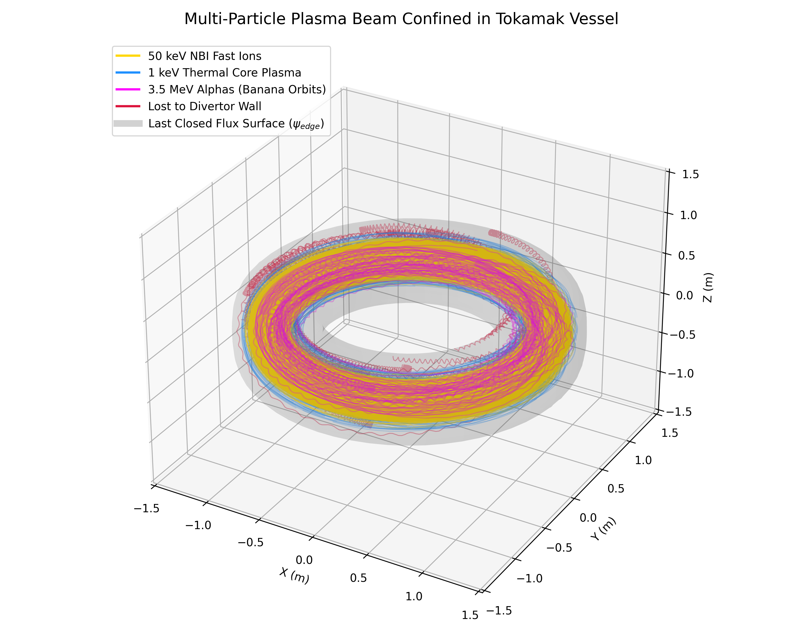

# Particle-In-Cell Tokamak Fusion Simulation

A particle-in-cell style simulation of ions in a magnetically confined tokamak plasma. It
solves a Grad–Shafranov equilibrium, pushes thermal deuterons, neutral-beam ions and 3.5 MeV
alphas through the resulting field with a Boris integrator, removes particles that cross the
last closed flux surface, and writes 11 diagnostic plots. Read *Scope and limitations* before
drawing conclusions from the numbers: several parts are prescribed rather than computed.

Written in Python with Numba JIT and PyTorch backends.



---

## How it works

Each timestep of the reactor run does the following, in this order:

1. **Sources.** Neutral beam injection adds 50 keV ions on a decaying schedule. One 3.5 MeV alpha is injected every 4 steps on a fixed schedule.
2. **Deposition and field solve.** Bulk ions are deposited on a 50×50 (R, Z) grid with cloud-in-cell weights, and one SOR pass of a Poisson solve updates the potential.
3. **Field lookup.** Each particle gets the local electric field from that grid and a magnetic field made of the toroidal B0·R0/R field, the poloidal field derived from the Grad–Shafranov flux, and a prescribed tearing-mode perturbation.
4. **Push.** The Boris integrator advances every particle's velocity and position under the Lorentz force. Alphas take 10 sub-steps per global step.
5. **Collisions.** At a fixed rate, a bulk ion's velocity direction is re-drawn isotropically with its speed unchanged.
6. **Losses.** Particles that cross the last closed flux surface are counted and removed.
7. **Alpha slowing-down.** Alphas lose a fixed fraction of their energy per step, and that energy is added to the bulk ions.
8. **Pellet trigger.** Once the prescribed tearing-mode amplitude passes a preset threshold, a scripted radiative drain starts scaling the bulk velocities down.
9. **Diagnostics.** Confined count, stored energy, bulk temperature and the Lawson triple product are recorded each step. Profiles, the phase-space map and the fusion power map are computed once from the final state and plotted.

## Physics and features

**Magnetic equilibrium.** `mhd_equilibrium.py` solves the Grad–Shafranov equation by SOR on a 60×60 rectangular (R, Z) box with a −R² source and ψ = 0 on the box edge. The result is cached to disk, so repeated runs skip the solve. The poloidal field is taken from the gradient of ψ and rescaled so the edge safety factor is 2; the toroidal field is the analytic B0·R0/R. Both are interpolated to each particle's position. The plasma boundary is the ψ = ψ_edge contour, and the same contour is used for the loss test, the plots and the plasma volume.

**Particle dynamics.** A 3D Boris pusher advances all particles. The bulk plasma is initialized from a 1 keV Maxwellian inside the core flux surface. The poloidal field gives the field lines a magnetic mirror, and trapped particles trace banana orbits; the alpha orbit plot shows them.

**Collisions.** `apply_vectorized_collisions` gives each bulk ion a probability ν_c·dt per step (ν_c = 5000 s⁻¹) of having its velocity direction re-drawn uniformly on the sphere. Speed is preserved, so this is isotropic re-randomisation at a fixed rate, not an energy-dependent Coulomb operator. Alphas are not collided.

**Neutral beam.** Beam ions are born at 50 keV near R = 1.05 m, inside the core flux surface, with a mostly perpendicular pitch. The batch size decays as exp(−step / 2500). Beam ions live in the same pool as the thermal ions and never slow down, so the reported bulk temperature (2/3 of the mean kinetic energy of that pool) rises as they accumulate.

**Alphas.** Alphas are not produced by fusion events. One is injected every 4 steps near R = 1.0 m, Z = 0 with an isotropic 3.5 MeV velocity. Each step an alpha gives up a fraction 2·ν_s·dt of its energy (down to a 15 keV floor), and the same energy is added to the bulk by scaling bulk speeds.

<p align="center">
  
</p>

**Fusion power map.** At the end of the run, the deposited density is rescaled so its peak is 1e20 m⁻³, split 50/50 into deuterium and tritium, and given a temperature proportional to the local density with the measured bulk temperature at the peak. The Bosch–Hale D–T reactivity then gives a power density, which is integrated over the grid for the printed total. The bulk ions themselves all carry the deuteron mass; there is no tritium species in the push.

**Lawson triple product.** Each step records n·T·τ with n = confined bulk macroparticles × 5e17 ÷ plasma volume, T = the bulk temperature, and τ = confined count ÷ particle loss rate, capped at 3 s. Until the first particle is lost there is no loss rate, and τ is a fixed 0.5 s placeholder; that part of the trace is not a measurement. The plot draws the 3e21 keV·s·m⁻³ reference line. Gain and ignition are not modelled.

**Tearing mode and pellet injection.** The tearing mode is a prescribed perturbation: an m=2, n=1 field ripple whose amplitude follows b0·exp(γt) from config constants and is added to the magnetic field each particle sees. It does not respond to the plasma. Pellet injection is a scripted radiative drain: when that amplitude passes a preset threshold (about step 5,200 of 10,000), the bulk velocities are scaled down each step by an impurity-radiation formula evaluated at the measured bulk temperature, with a 10 eV floor.

**Fluid moments.** Radial density and pressure profiles are computed once, from the final particle state, by binning surviving particles into cylindrical shells.

**Charge deposition and field solve.** Cloud-in-cell deposition and an SOR Poisson solve run every step as structural scaffolding for a PIC loop. The resulting field is gathered and applied in the push, but it is not a self-consistent electrostatic field (see *Scope and limitations*). The deposited density is also what the fusion power map is built from.

**Dual backends.** The reactor loop exists as a Numba JIT CPU implementation and a PyTorch GPU implementation (CUDA or Apple MPS), chosen at runtime (see *Choosing the CPU or GPU path*).

## Graphical outputs

A reactor run writes 10 plots to the working directory. The benchmark writes one more.

### Reactor run (`python main.py`)

**Orbits and phase space**

| Output | What it shows |
|---|---|
| `tokamak_reactor_2d.png` | Sampled particle trajectories in the poloidal plane over the flux surfaces, with the last closed flux surface and wall strikes. |
| `tokamak_reactor_3d.png` | The same trajectories in 3D, with a sample of alpha orbits. |
| `alpha_orbits.png` | A sample of 3.5 MeV alpha orbits against thermal and beam-ion tracks. |
| `phase_space_map.png` | Major radius against velocity parallel to the local magnetic field, for every surviving particle. |

**Time traces**

| Output | What it shows |
|---|---|
| `plasma_stored_energy_time.png` | Total kinetic energy of the bulk ions over time. |
| `lawson_triple_product.png` | The triple product described above, against the 3e21 keV·s·m⁻³ reference line. |

**Normalised or unweighted maps**

| Output | What it shows |
|---|---|
| `fusion_power_density.png` | D–T fusion power density, with the density normalised to a 1e20 m⁻³ peak. |
| `radial_profiles.png` | Radial density and pressure moments of the final particle state, as unweighted macroparticle values. |

<p align="center">
  
</p>
<p align="center"><em>D–T fusion power density, density normalised to a 1e20 m⁻³ peak.</em></p>

**Electrostatic scaffolding**

| Output | What it shows |
|---|---|
| `charge_density_map.png` | Cloud-in-cell charge deposition on the grid, one elementary charge per macroparticle. |
| `potential_field_map.png` | Potential from the unconverged SOR Poisson solve on that deposition. |

### Standalone diagnostic

| Entry point | Output | What it shows |
|---|---|---|
| `benchmarks.run_hpc_benchmark(cfg)` | `benchmark_scaling.png` | Runtime of the Boris push versus particle count on your hardware, for both backends. |

### Reading the results

- **Tied to the simulation:** the orbit plots (`tokamak_reactor_2d.png`, `tokamak_reactor_3d.png`, `alpha_orbits.png`), the phase-space map, the stored energy trace and the triple product are measured from the particles the loop pushes. The triple product's density carries the 5e17 macro-weight, and its early segment, before the first particle loss, uses a placeholder confinement time.
- **Normalised or unweighted:** the fusion power density is normalised to a 1e20 m⁻³ peak density, and the radial profiles are unweighted macroparticle counts and moments. Read their shapes, not their absolute values.
- **Scaffolding:** the charge density and potential maps show the deposition and solver running. They are not a converged electrostatic field.

---

## Performance

Production case: 50,000 particles, 10,000 steps, CPU/Numba path.

| | loop wall |
|---|---|
| baseline | 88.4 s |
| optimized | 33.0 s |

The dominant cost in the original loop was not computation. Profiling showed roughly 65% of
the Boris push stage was masked gather/scatter — building boolean masks over the full particle
array, copying the selected rows out, pushing them, and writing them back — to operate on a
species that made up a fraction of a percent of the population. Restructuring particles into
contiguous per-species memory pools removed that pattern entirely; the two sub-timers that
measured it now total 0.006 s of a 20.4 s stage.

Every optimization was verified numerically inert against a byte-level regression harness:
43 arrays, bit-identical, strict `rtol=1e-6`. The 2,437-line main module was subsequently
split into eight modules across eight commits, each one proven bit-identical.

---

## Scope and limitations

- **No electrons, no self-consistent field.** There is no electron population and no
  neutralising background, so the deposited charge is purely positive. The 50×50 grid
  under-resolves the Debye length by about 870× (at 1e20 m⁻³ and 1 keV), so a resolved
  electrostatic solve isn't meaningful at this scale.
- **The Poisson solve does not converge.** Its stopping test is an absolute change of
  `1e-5` V per sweep, which the first sweep never exceeds, so it exits after a single sweep
  every step. The stored potential (about 3e-5 V at the end of a production run) is a running
  sum of unconverged sweeps. The field is still applied in the push.
- **Charge deposition is unweighted.** Each macroparticle deposits one elementary charge. The
  5e17 macro-weight is applied only to the density in the Lawson triple product.
- **Fusion power is normalised.** The power map rescales the deposited density to a 1e20 m⁻³
  peak and assumes a temperature profile proportional to density, so its absolute value is
  set by that normalisation.
- **The alpha source is scheduled.** One alpha is injected every 4 steps regardless of the
  fusion rate. Alphas are not spawned from fusion events.
- **Collisions are a fixed-rate isotropic re-randomisation** of bulk-ion velocity direction,
  not pitch-angle scattering from a Coulomb operator.
- **The tearing mode and pellet injection are prescribed.** The perturbation amplitude is an
  exponential set by config constants, and the radiative drain fires when that amplitude
  passes a preset value.
- **Gain and ignition are not modelled.** There is no Q-factor, no power balance, and no
  bremsstrahlung or cyclotron loss. The only radiative loss is the scripted drain after the
  pellet trigger. The 3e21 line on the triple-product plot is a reference value, and the
  trace's confinement time is a particle-loss proxy with a placeholder before the first loss.
- **One ion mass.** All bulk ions carry the deuteron mass; tritium appears only as half of
  the density in the fusion power map.

---

## Installation

Running in a virtual environment is strongly recommended.

```bash
git clone https://github.com/johndominianni03/Nuclear-Fusion-Simulation.git
cd Nuclear-Fusion-Simulation
```

**macOS / Linux** (macOS uses Apple Metal Performance Shaders for PyTorch)

```bash
python3.9 -m venv venv
source venv/bin/activate
pip install -r requirements.txt
```

**Windows** (uses NVIDIA CUDA for PyTorch)

```bash
python -m venv venv
venv\Scripts\activate
pip install torch torchvision torchaudio --index-url https://download.pytorch.org/whl/cu126
pip install numba numpy pandas matplotlib scipy
```

---

## Running it

The main reactor run, which writes the 10 reactor plots into the working directory
(set `FUSION_HEADLESS=1` to run without an interactive display):

```bash
python main.py
```

Or, to call it directly and control plotting:

```bash
python -c "import main; main.run_reactor_steady_state()"
```

The benchmark lives behind its own entry point and is not part of the reactor run:

```bash
python -c "import benchmarks, config; benchmarks.run_hpc_benchmark(config.SimulationConfiguration())"   # benchmark_scaling.png
```

**Profiling.** Set `cfg.PROFILE = True` in `config.py` to print per-stage wall-clock tables:
the loop table, the deuteron-push breakdown, the SOR iteration histogram, and an out-of-loop
table. Plot writing is gated behind it — a profiling run writes no PNGs unless you pass
`save_plots=True` explicitly.

**Regression tests.**

```bash
python tests/test_regression.py compare           # strict, rtol 1e-6
python tests/test_regression.py compare --loose   # rtol 1e-3
python tests/test_regression.py compare-plots     # renders to a temp dir, diffs the manifest
python tests/test_maxwellian.py                   # Maxwellian sampling check
```

### Choosing the CPU or GPU path

The simulation dispatches between a Numba JIT loop and a PyTorch loop at runtime, based on
`GPU_PARTICLE_THRESHOLD` in `main.py` and `initial_thermal_count` in `config.py`.

`GPU_PARTICLE_THRESHOLD` **defaults to `None`, which always selects the CPU path.** That is
deliberate: on the development machine (Apple Silicon / MPS) the Numba loop measured faster at
every particle count tested, up to 3,000,000 — 32–36 s against 69.6 s for the GPU loop at
1M particles / 200 steps. The GPU path is fully functional and maintained, just not the default. On the other hand, the GPU path running PyTorch runs faster on PCs with discrete GPUs, as the entire main loop can be allocated to the GPU, whereas on Apple Silicon, the GPU is integrated with the CPU as part of the System-on-a-Chip architecture; for the CPU loop on Numba, the simulation will run slower than on a Mac, as the SOC architecture on a Mac is superior for CPU runs.

To force the GPU path, set the threshold to any integer at or below your particle count, either
by editing `main.py` or at runtime:

```python
import main
main.GPU_PARTICLE_THRESHOLD = 0
main.run_reactor_steady_state()
```

Performance scales with hardware on both paths. The GPU path is expected to do better on a
discrete NVIDIA card than on Apple Silicon: a unified-memory architecture cannot fully offload
the workload to the GPU, whereas a discrete card can. On Apple Silicon, memory bandwidth
(GB/s) is the dominant factor.

---

## Architecture

| module | lines | holds |
|---|---|---|
| `reactor_gpu.py` | 611 | the PyTorch reactor loop |
| `reactor_cpu.py` | 603 | the Numba reactor loop, adaptive Boris push |
| `main.py` | 312 | entry points, loop dispatch, result packaging |
| `physics_engine.py` | 1119 | physics kernels, CPU and torch |
| `track_store.py` | 280 | trajectory sampling, pid→row maps |
| `profiling.py` | 200 | per-stage wall-clock instrumentation |
| `particle_pool.py` | 166 | capacity-backed particle pools, compaction |
| `kernels.py` | 152 | field gather, collisions |
| `benchmarks.py` | 75 | hardware scaling sweep |

Plus `config.py`, `mhd_equilibrium.py` (Grad–Shafranov solve with disk cache),
`initialization.py`, `diagnostics.py`, `visualizer.py`, `tests/test_regression.py`, and
`tools/`.

---

## Optimization and verification

Four changes to the hot loop:

- **Allocation-free field gather.** The gather kernel allocated and freed a fresh pair of
  `(N, 3)` float32 arrays every step — 24 MB per step at 1M particles, ~10,000 times per run.
  Replaced with an out-parameter form writing into buffers allocated once.
- **Vectorized trajectory history.** Four pid-keyed Python dicts replaced with slot-indexed
  arrays and a single flat vertex buffer, regrouped once at end of run by a stable argsort.
- **Capacity-backed particle pools.** Particle arrays were grown by full reallocation on every
  injection. Replaced with fixed-capacity pools and an `n_live` pointer, with a hard ceiling
  that raises rather than growing silently.
- **Split bulk and alpha pools.** The change that mattered. Five boolean masks eliminated;
  every kernel now runs on a contiguous `[:n_live]` view.

Verification throughout was bit-identity rather than tolerance: a 43-array dump compared
byte-for-byte against a reference tree. Where a stage gain was real but the whole-loop
difference sat inside run-to-run noise, no total speedup is claimed.
