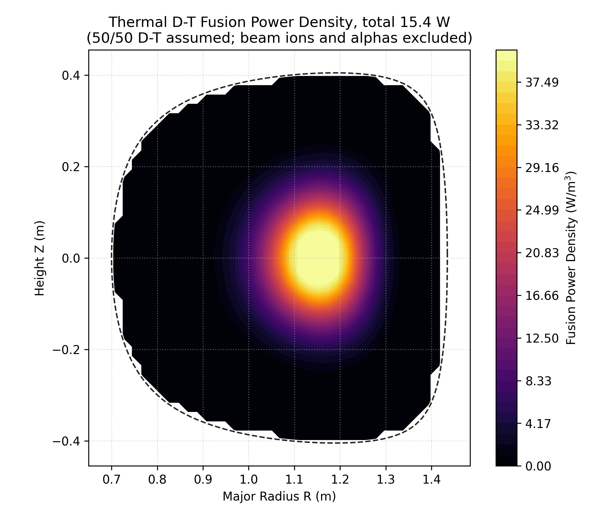
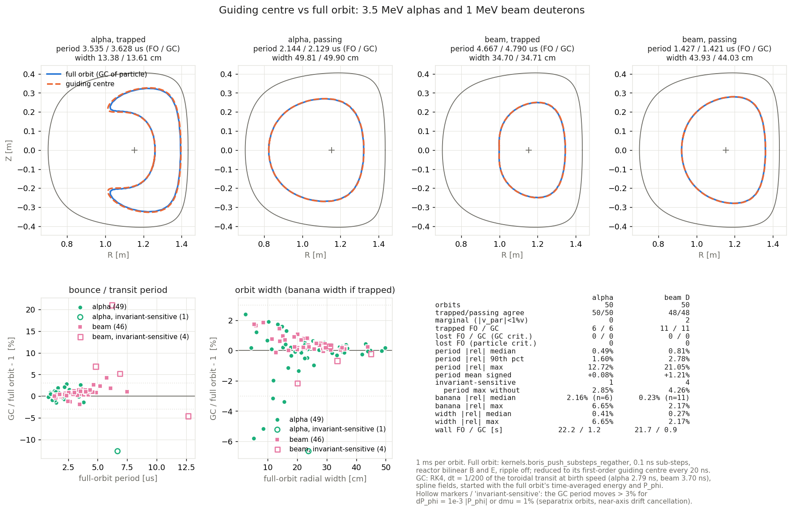
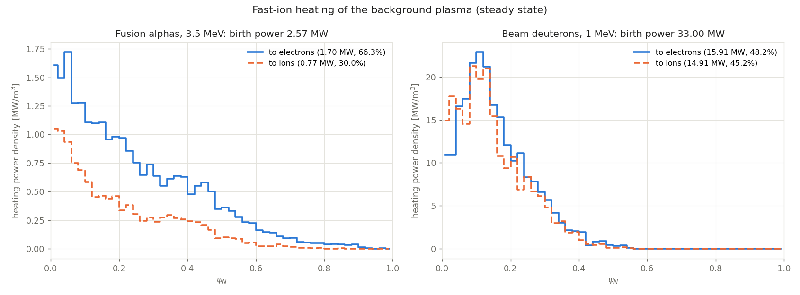
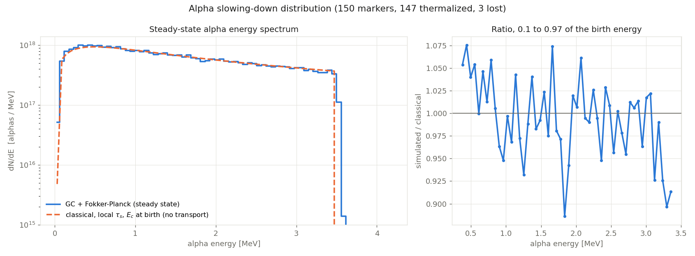
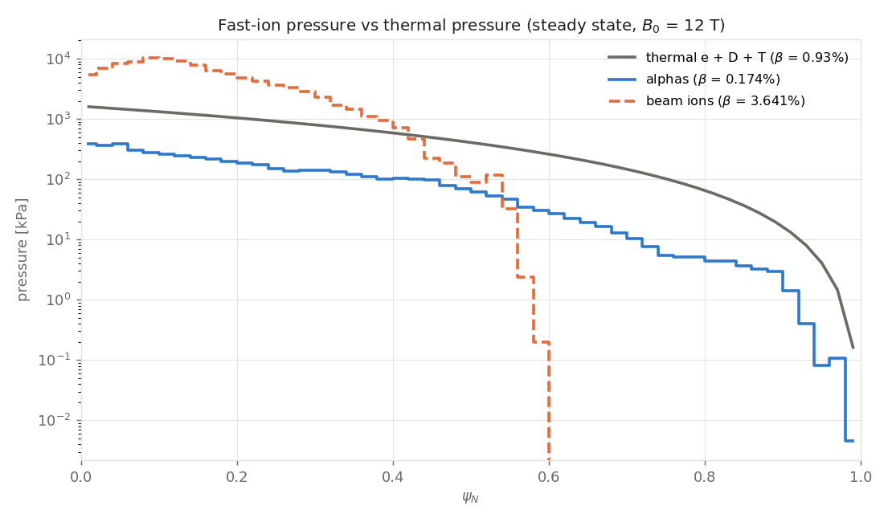
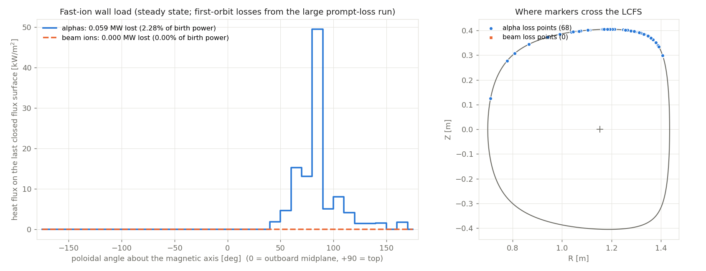
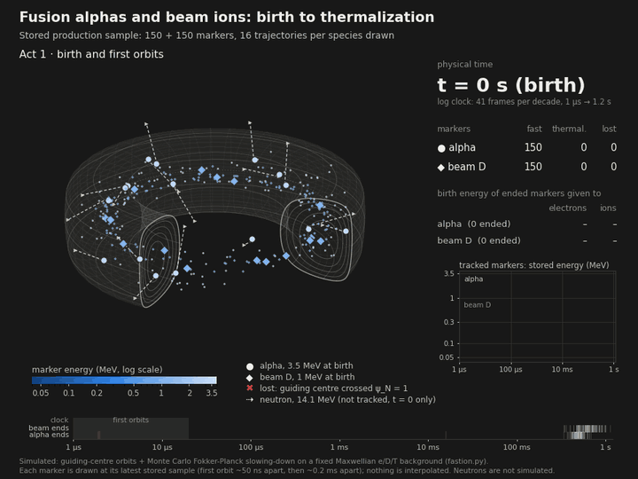

# Particle-In-Cell Tokamak Fusion Simulation

A particle-in-cell style simulation of ions in a magnetically confined tokamak plasma. It
solves a Grad–Shafranov equilibrium, pushes thermal deuterium and tritium, neutral-beam
deuterons and 3.5 MeV fusion alphas through the resulting field with a Boris integrator, removes particles that cross the
last closed flux surface, and writes 11 diagnostic plots. The plasma conditions are referenced to the ITER Q = 10
baseline (see *Scenario*). Read *Scope and limitations* before drawing conclusions from the numbers: there are no
electrons, and some parts are prescribed rather than computed.

A separate fast-ion module follows the alphas and beam ions for their whole ~0.5 s slowing-down
with a guiding-centre pusher and a Monte Carlo Fokker–Planck collision operator (see *Fast-ion
slowing-down module*).

Written in Python with Numba JIT and PyTorch backends.


---

## How it works

Each timestep of the reactor run does the following, in this order:

1. **Beam source.** Neutral beam injection adds 1 MeV deuterons at a constant injected power (33 MW).
2. **Electric field and fusion rate.** At step 0 and every 100 steps, the thermal D and T density and pressure profiles are measured on flux surfaces. The radial electric field is rebuilt from ion force balance on a 50×50 (R, Z) grid, and the D–T reaction rate of each flux surface is recomputed from the same profiles.
3. **Alpha source.** 3.5 MeV alphas are born from that computed reaction rate, on the flux surfaces where the reactions happen.
4. **Field lookup.** Each particle gets the local electric field from that grid and a magnetic field made of the toroidal B0·R0/R field, the poloidal field derived from the Grad–Shafranov flux, and a prescribed tearing-mode perturbation.
5. **Push.** The Boris integrator advances every particle's velocity and position under the Lorentz force. Beam deuterons and alphas take 10 sub-steps per global step, with the field re-evaluated at each sub-step.
6. **Collisions.** At a fixed rate per species (the NRL ion collision rate at the loaded central density and temperature), a thermal or beam ion's velocity direction is re-drawn isotropically with its speed unchanged.
7. **Losses.** Particles that cross the last closed flux surface are counted and removed, and the kinetic energy each species carries out is recorded.
8. **Alpha slowing-down.** Alphas lose a fixed fraction of their energy per step, down to (3/2)·T_i of the thermal ions on their flux surface, and that energy (weighted by each alpha's weight) is added to the thermal D and T.
9. **Diagnostics.** Confined count, stored energy per species, the thermal-ion temperature, the ion energy confinement time and the Lawson triple product are recorded each step. The flux-surface profiles, ion density map, phase-space map and fusion power map are computed once from the final state and plotted.

## Scenario

The plasma conditions are inputs taken from the ITER Q = 10 baseline. Each is marked as a scenario input in `config.py` with its source.

| | value | source |
|---|---|---|
| Thermal-ion temperature on axis | 25 keV, T = T₀(1 − ψ_N) | ITER Q = 10 baseline modelling, T_D,T(0) ≈ 25 keV ([arXiv:2306.08442](https://arxiv.org/abs/2306.08442), METIS scenario) |
| Volume-averaged ion density | 1×10²⁰ m⁻³, n = n₀(1 − ψ_N), so n₀ = 2.03×10²⁰ m⁻³ on axis | ITER-class density |
| Neutral beam | 33 MW of 1 MeV deuterium | ITER heating beams (2 × 16.5 MW at 1 MeV D⁰) |
| Toroidal field | B0 = 12 T at R0 = 1 m | **not ITER**: a high-field compact device (ITER is 5.3 T at 6.2 m) |

The device is therefore a compact, high-field tokamak (minor radius ~0.35 m, plasma volume 3.5 m³) run at ITER-like ion temperature, density and beam power. Physical constants are CODATA 2022 (`constants.py`).

## Physics and features

**Magnetic equilibrium.** `mhd_equilibrium.py` solves the Grad–Shafranov equation by SOR on a 60×60 rectangular (R, Z) box with a −R² source and ψ = 0 on the box edge. The result is cached to disk, so repeated runs skip the solve. The poloidal field is taken from the gradient of ψ and rescaled so the edge safety factor is 2; the toroidal field is the analytic B0·R0/R. Both are interpolated to each particle's position. The plasma boundary is the ψ = ψ_edge contour, and the same contour is used for the loss test, the plots and the plasma volume.

**Species.** Four species, each in its own contiguous memory pool so every kernel runs on a contiguous array: thermal deuterium (type 0), beam deuterium (type 1), alphas (type 2) and thermal tritium (type 3). Masses are the CODATA 2022 deuteron, triton and alpha-particle masses.

**Particle dynamics.** A 3D Boris pusher advances all particles. The 50,000 thermal macroparticles are 25,000 D and 25,000 T, and each species fills the whole last closed flux surface with the same peaked profiles, n = n₀(1 − ψ_N) and T = T₀(1 − ψ_N), where ψ_N runs from 0 on the magnetic axis to 1 at the boundary and T₀ = 25 keV. The 1 ns step gives ω_c·dt = 0.58 rad for deuterons and 0.38 rad for tritons at B0 (0.82 / 0.55 at the strongest field on the boundary), and the magnetic moment of thermal D and T at 25 keV is conserved at that step (tested). The poloidal field gives the field lines a magnetic mirror, and trapped particles trace banana orbits; the alpha orbit plot shows them.

**Per-species weights.** Each macroparticle stands for a number of real ions set by its species. Thermal D and T carry about 7×10¹⁵, so the volume-averaged ion density is 1×10²⁰ m⁻³ (n_D + n_T on axis ≈ 2×10²⁰ m⁻³). Beam ions carry about 1×10¹¹ (set by the beam power, below), and each alpha carries the weight it was born with (about 4.6×10⁹ at 25 keV). Every quantity that turns macroparticles into physics multiplies by those weights: the flux-surface profiles and β, the ion density map, stored energy, the thermal temperature, the Lawson density, and the alpha-to-bulk energy transfer, which conserves real energy even though the weights differ by 10¹¹.

**Collisions.** `apply_vectorized_collisions` gives each thermal and beam ion a probability ν·dt per step of having its velocity direction re-drawn uniformly on the sphere. ν is the NRL Plasma Formulary ion collision rate, ν_i = 4.80×10⁻⁸ Z⁴ μ^(−1/2) n_i T_i^(−3/2) ln Λ s⁻¹ (n in cm⁻³, T in eV, μ = m/m_p), with the NRL mixed ion–ion Coulomb logarithm, evaluated once at the loaded central density (n₀ = 2.03×10²⁰ m⁻³, half D, half T) and temperature (25 keV): ln Λ = 21.7, ν_D = 38 s⁻¹ (thermal and beam D), ν_T = 31 s⁻¹. Speed is preserved, so this is still isotropic re-randomisation at a fixed rate, not an energy-dependent Coulomb operator. Alphas are not collided. Over a 10 µs run each ion collides with probability ~4×10⁻⁴.

**Neutral beam.** The beam is calibrated by power. The injected power P_NBI = 33 MW is an input (ITER's neutral-beam heating power), not a result. Two beam macroparticles are injected per step, each of weight w_beam = P_NBI·dt / (E_beam × 2) ≈ 1.03×10¹¹ deuterons, about 68,000 times lighter than a thermal macroparticle, so the weighted injected power is 33 MW while the beam keeps good statistics. Beam ions are born at 1 MeV near R = 1.05 m, inside the core flux surface, with a mostly perpendicular pitch, and have their own pool. A 1 MeV deuteron covers about 1 cm per 1 ns step against a 1.7 cm Larmor radius, the regime the alphas are sub-stepped for, so the beam is pushed the same way: 10 sub-steps (no more gyro-phase per sub-step than an alpha sub-step, 0.058 rad) with the field looked up at each one. Beam ions never slow down. Over a 10 µs run they reach about 2×10¹⁵ m⁻³ on axis and hold about 330 J; none is lost.

**Alphas.** Alphas are born from the computed thermal fusion rate. At every field update the D–T reaction rate of each flux surface, rate_k = n_D·n_T·⟨σv⟩(T_i)·V_k, is recomputed from the thermal profiles. One macro-alpha is born per step, with weight w_alpha = (Σ_k rate_k)·dt, so the weighted birth rate is the fusion reaction rate. A birth picks a surface with probability proportional to rate_k, then a position inside it by rejection sampling on ψ_N and a random toroidal angle, with an isotropic 3.5 MeV velocity. The alpha pool stores one weight per alpha, which it keeps for life. A 3.5 MeV alpha covers about 1.3 cm per 1 ns step against a 2.2 cm Larmor radius, so alphas take 10 Boris sub-steps per step, and the electric and magnetic fields are looked up again at every sub-step. An earlier version held the field fixed at the start-of-step position across all 10 sub-steps. That broke conservation of the magnetic moment and drove every alpha's pitch to v∥/v = −1 within about 2 µs. A test now checks that the magnetic moment is conserved. Each step an alpha gives up a fraction 2·ν_s·dt of its energy, down to (3/2)·T_i of the thermal ions on its own flux surface (from the latest profiles), and the same energy is added to the thermal D and T by scaling their speeds. About 4% of the alphas born in a run are lost through the boundary.

<p align="center">
  
</p>

**Fusion power.** Thermal D–T fusion power is computed from the measured thermal-D and thermal-T profiles. On each flux surface P = n_D·n_T·⟨σv⟩(T_i)·17.6 MeV with the Bosch–Hale reactivity, where T_i is the density-weighted thermal-ion temperature (n_D·T_D + n_T·T_T)/(n_D + n_T). The total is the sum of P times shell volume over the surfaces, and the map shows P(ψ_N) at the end of the run drawn on the R–Z plane. Beam ions and alphas are excluded, so this is the thermonuclear power of the thermal plasma alone. At 25 keV on axis it is about 13 MW (alpha birth rate 4.6×10¹⁸ s⁻¹); the same code at a 1 keV peak gives about 73 W.

**Lawson triple product.** Each step records n·T·τ_E with n = the weighted thermal-ion (D + T) density, real thermal ions ÷ plasma volume (1×10²⁰ m⁻³), T = the thermal-ion temperature (thermal D and T only), and τ_E = W_th / P_loss: W_th is the weighted thermal D + T kinetic energy and P_loss the weighted kinetic energy thermal ions carry out through the last closed flux surface, averaged over a trailing 1 µs window. This is ion energy confinement from orbit losses only: there are no electrons and no transport model. τ_E is undefined (not drawn) before the first thermal-ion loss and whenever the window holds no loss. At 25 keV a production run loses only about five thermal macroparticles, so the trace is a handful of steps and τ_E (median ~0.03–0.1 s between runs) carries large counting noise; at 1 keV no thermal ion is lost and τ_E is not measured. The plot draws a 3e21 keV·s·m⁻³ reference line. Gain and ignition are not modelled.

**Tearing mode.** The tearing mode is a prescribed perturbation: an m=2, n=1 field ripple whose amplitude follows b0·exp(γt) from config constants and is added to the magnetic field each particle sees. It does not respond to the plasma, and it triggers nothing. Its amplitude at the end of a run is reported: 1.2×10⁻⁵ of B0.

**Flux-surface profiles.** Particles are binned by ψ_N into 25 shells. Each shell's volume is measured from the equilibrium on a 400×400 (R, Z) mesh, and the shell volumes add up to the plasma volume within 0.03%. For each species (thermal D, thermal T, beam D, alpha), and using that species' mass and weights, each shell gives the weighted density, the mean flow in the local (R, φ, Z) basis, the temperature T = m⟨|v − u|²⟩/3, and the pressure nT. β = 2μ₀Σp/B₀² is reported as a volume average.

**Electric field.** The plasma is treated as quasi-neutral, as in orbit-following codes, and the radial field is taken from thermal-ion force balance with no rotation: E = ∇p_i/(e·n_i), with n_i = n_D + n_T and p_i = p_D + p_T. As a flux function, dΦ/dψ_N = −(1/(e·n_i))·dp_i/dψ_N and E = −(dΦ/dψ_N)·∇ψ_N. The profiles are smoothed with cubic smoothing splines weighted by counting statistics before differentiating. Surfaces holding fewer than 100 thermal ions carry no field, and E is zero outside the last closed flux surface. The field is rebuilt from the current particles every 100 steps. Between updates the profiles change by about 0.3% against 2% counting noise. In a 25 keV production run Φ on axis is about −47 kV, |E| is about 4×10⁵ V/m and at most 6.5×10⁵ V/m, and the E×B drift is at most 74 km/s, small against the ~1.5×10⁶ m/s thermal speed. A self-consistent electrostatic solve would have to resolve a Debye length of about 2×10⁻⁵ m and the electron plasma frequency, which is out of reach at this scale.

**Ion density map.** The weighted ion density is deposited on the 50×50 grid with cloud-in-cell weights, once, from the final state.

**Dual backends.** The reactor loop exists as a Numba JIT CPU implementation and a PyTorch GPU implementation (CUDA or Apple MPS), chosen at runtime (see *Choosing the CPU or GPU path*).

## Graphical outputs

A reactor run writes 10 plots to the working directory. The benchmark writes one more.

### Reactor run (`python main.py`)

**Orbits and phase space**

| Output | What it shows |
|---|---|
| `tokamak_reactor_2d.png` | Sampled particle trajectories in the poloidal plane over the flux surfaces, with the last closed flux surface and wall strikes. |
| `tokamak_reactor_3d.png` | The same trajectories in 3D, with a sample of alpha orbits. |
| `alpha_orbits.png` | A sample of the tracked 3.5 MeV alpha orbits (born from the computed fusion rate) against thermal D, thermal T and a sample of beam-ion tracks. |
| `phase_space_map.png` | Major radius against velocity parallel to the local magnetic field for every surviving particle, one panel per pool (thermal D and T, beam D, alphas), each scaled to its own largest \|v∥\|. |

**Time traces**

| Output | What it shows |
|---|---|
| `plasma_stored_energy_time.png` | Weighted kinetic energy of each species (thermal D, thermal T, beam D, alpha) over time, in joules, on a log axis. |
| `lawson_triple_product.png` | The triple product with τ_E from thermal-ion orbit losses (gaps where τ_E is undefined), against the 3e21 keV·s·m⁻³ reference line. |

**Profiles and fields** (all weighted, physical units)

| Output | What it shows |
|---|---|
| `radial_profiles.png` | Density, temperature and pressure of each species (thermal D, thermal T, beam D, alpha) against ρ = √ψ_N, with volume-averaged β in the title. |
| `fusion_power_density.png` | Thermal D–T fusion power density in W/m³ from the thermal D and T profiles (beam ions and alphas excluded), with the total. |
| `ion_density_map.png` | Ion density (m⁻³), weighted cloud-in-cell deposition of every ion at the end of the run. |
| `potential_field_map.png` | Potential Φ (V) of the quasi-neutral field from ion pressure balance, with no rotation. |

<p align="center">
  
</p>
<p align="center"><em>Thermal D–T fusion power density from the thermal D and T flux-surface profiles, end of run.</em></p>

### Standalone diagnostic

| Entry point | Output | What it shows |
|---|---|---|
| `benchmarks.run_hpc_benchmark(cfg)` | `benchmark_scaling.png` | Runtime of the Boris push versus particle count on your hardware, for both backends. |

### Reading the results

- **Tied to the simulation:** every plot is measured from the particles the loop pushes. Densities, pressures, the triple product and the fusion power carry the macroparticle weight, so they are in physical units.
- **Assumptions to keep in mind:** the fusion power counts only thermal ions. The potential is a force-balance field with no rotation, not an electrostatic solve. Beam and alpha slowing-down are not modelled physically, and the run is far shorter than either slowing-down time, so neither source visibly heats the plasma. τ_E counts ion orbit losses only. See *Scope and limitations*.

---

## Performance

Production case: 50,000 particles, 10,000 steps, CPU/Numba path.

| | loop wall |
|---|---|
| baseline | 88.4 s |
| optimized | 33.0 s |
| after the Tier 1 physics changes | 34.6 s |
| after the Tier 2 physics changes | 55 s |
| after the Tier 2.5 physics changes | 92 s |

The Tier 1 line is slightly slower than the optimized one, and the difference buys accuracy. The main cost is that alphas now look up the field at every one of their 10 sub-steps instead of once per step. Replacing the per-step Poisson solve with a force-balance field rebuilt every 100 steps made up most of that cost. The Tier 2 line pays for physical sources: the power-calibrated beam injects 20,000 beam macroparticles per run (about 6,000 before), and the fusion-driven source 10,000 sub-stepped alphas (2,500 before). The Tier 2.5 line is the 1 MeV beam: its 20,000 ions now take 10 sub-steps each with the field looked up at every one, like the alphas.

The dominant cost in the original loop was not computation. Profiling showed roughly 65% of
the Boris push stage was masked gather/scatter — building boolean masks over the full particle
array, copying the selected rows out, pushing them, and writing them back — to operate on a
species that made up a fraction of a percent of the population. Restructuring particles into
contiguous per-species memory pools removed that pattern entirely; the two sub-timers that
measured it now total 0.006 s of a 20.4 s stage.

Every optimization was verified numerically inert against a byte-level regression harness:
every recorded array, bit-identical, strict `rtol=1e-6`. The 2,437-line main module was subsequently
split into eight modules across eight commits, each one proven bit-identical.

## Fast-ion slowing-down module

The reactor run lasts 10 µs, while alphas and beam ions take ~0.5 s to slow down. A separate
module, `fastion.py`, follows them for their whole slowing-down, the way fast-ion codes such as
ASCOT and LOCUST do: guiding-centre orbits in the equilibrium, plus Monte Carlo Coulomb collisions
with fixed Maxwellian background electrons, deuterons and tritons. It reuses the reactor's
equilibrium, scenario and alpha source; it does not change the 10 µs run, whose regression stays
bit-identical.

```bash
venv/bin/python fastion.py                      # production, ~70 min: plots, data/fastion_*.npz
venv/bin/python tools/gc_vs_full_orbit.py       # GC vs full-orbit benchmark, ~1 min
venv/bin/python -m pytest tests/test_fastion.py -q
```

**Fields** (`fields_gc.py`). The guiding-centre equations need second derivatives of ψ, which the
reactor's bilinear field grids do not have. The same ψ — the reactor's 60×60 Grad–Shafranov
solution times the reactor's own q-rescale factor — is represented by an interpolating bicubic
spline, giving B_R = −(1/R)∂ψ/∂Z, B_Z = (1/R)∂ψ/∂R, B_φ = B0·R0/R, |B|, ∇|B|, b and ∇×b, and an
exactly divergence-free field. The electric field is Tier 1's quasi-neutral ion force balance,
e·n_i·E = ∇p_i, for the background profiles: Φ = −(2T₀/e)(1 − ψ_N), −50 kV on axis. The prescribed
tearing-mode ripple is left out: it breaks axisymmetry and is ~10⁻⁵ of B0.

**Background** (`background.py`). Electrons, deuterons and tritons with n, T ∝ 1 − ψ_N, 25 keV on
axis, n_D = n_T, n_e = n_D + n_T, and n₀ = 2.03×10²⁰ m⁻³ (the reactor's, volume average 10²⁰ m⁻³).
T_e = T_i is assumed; ITER Q = 10 modelling has T_e(0) ≈ 27 keV against T_i(0) ≈ 25 keV
([arXiv:2306.08442](https://arxiv.org/abs/2306.08442)).

**Guiding-centre pusher** (`gc_push.py`). The non-relativistic B* equations (Littlejohn 1983;
Cary & Brizard 2009) with E from Φ, integrated by fixed-step RK4 in a Numba `prange` kernel. The
step is 1/200 of the marker's toroidal transit time at its current speed: 2.79 ns for a 3.5 MeV
alpha, 3.70 ns for a 1 MeV deuteron, longer as it slows. A marker is lost when its guiding centre
crosses ψ_N = 1. Energy W = ½mv∥² + μB + qΦ and canonical momentum P_φ = m·v∥·b_φ·R + qψ are
invariants (this code's ψ sign convention gives +qψ).

**Collisions** (`collisions_fp.py`). The Monte Carlo operator of Boozer & Kuo-Petravic (1981): a
Lorentz pitch-angle step and a drag-plus-energy-diffusion speed step per background species, with
the NRL Plasma Formulary's Chandrasekhar-function coefficients. One Coulomb logarithm per species
pair, set by the local plasma (NRL electron–ion form; NRL counterstreaming-ion form at the test
species' critical speed), so the background Maxwellian stays the operator's equilibrium. The energy
each step gives to electrons and to ions is accounted exactly.

**Following a marker** (`fastion.py`). Alphas are born from the thermal D–T reaction rate of the
background profiles (the Tier 2 alpha source), isotropic at 3.5 MeV; beam ions from the reactor's
injector at 1 MeV. Each marker carries a birth-rate weight (alphas: the fusion rate / N; beams:
P_NBI/E_beam / N). Every step: fields at the guiding centre, one collision step, one RK4 step. A
marker ends when it thermalizes, at E < 2 × (3/2)·T_i local, or crosses the last closed flux
surface. Time-integrating the weighted histories gives the steady state: fast-ion density and
pressure, heating power to electrons and to ions per flux surface, loss fractions and the wall
heat load. Prompt (first-orbit, < 100 µs) losses come from a separate run of 4,000 markers per
species for 1 ms, since they are too rare to count well in the full runs.

### Validation

Every component was tested against an analytic or independent result before the production run
(`tests/test_fastion.py`, 17 tests, ~30 s):

| test | known answer | measured | bound |
|---|---|---|---|
| spline ψ at the 60×60 nodes | the reactor's q-rescaled ψ | 4×10⁻¹⁴ | 10⁻⁶ |
| spline B at the reactor's 50×50 field-grid nodes | the reactor's bilinear B | 4.2×10⁻⁴ of \|B\| (the reactor's finite-difference error: falls 3.98×, 4.02× per halving of h) | 10⁻³ |
| ∇·B (central differences) | 0 | 1.3×10⁻⁷ B_pol/a (reactor grids: 6×10⁻³) | 10⁻⁶ |
| ∇×b, ∇\|B\| | finite differences | 1.7×10⁻¹⁰, 1.4×10⁻¹⁰ | 10⁻⁵ |
| background ∫n_i dV | N_AVG × volume | +0.15% | 0.5% |
| GC energy, 10⁵ steps, trapped and passing alphas | conserved | 2.4×10⁻⁸ | 10⁻⁶ |
| GC P_φ, same orbits | conserved | 1.3×10⁻⁷ | 10⁻⁶ |
| trapped/passing boundary, ψ_N = 0.2, 0.5, 0.8 | √(1 − B_min/B_max) on the surface | −0.60%, −0.36%, −0.28% | 5% |
| GC vs full orbit, 50 alphas + 50 beam ions, 1 ms | the reactor's Boris pusher | see below | few % |
| Spitzer slowing-down time, 3.5 MeV alpha on electrons | τ_s = 0.692 s | +1.8% | 3% |
| time from 3.5 to 0.35 MeV, full plasma | (τ_s/3)·ln[(1 + x₀^1.5)/(1 + x₁^1.5)] | +1.5% | 3% |
| steady-state distribution, 0.1–0.95 E₀ | f ∝ 1/(v³ + v_c³) | χ² p = 0.75 (27,807 samples) | p > 0.01 |
| alpha energy fraction to ions | Stix: (1/x)∫₀ˣ dy/(1 + y^1.5), x = 3.52 | 0.3904 vs 0.3949 (−1.1%) | 2% |
| pitch-angle relaxation of ⟨ξ⟩ | exp(−ν_D t), ν_D = 0.142 s⁻¹ | +0.53% | 3% |
| thermalization | background Maxwellian | KS p = 0.026, ⟨E⟩/T = 1.486 | p > 0.01 |
| energy balance of a seeded run (lost, thermalized and running markers) | closes | \|residual\| ≤ 1.2×10⁻⁶ of birth power | 1% |
| seeded small run | `tests/golden/fastion_regression.npz` | bit-identical (any thread count) | exact |

The critical energy in the Stix test is the operator's own, E_c = 995 keV on axis. Stix's
14.8·A·T_e formula gives 821 keV because it assumes equal ion and electron Coulomb logarithms;
here ln Λ_i/ln Λ_e = 23.5/17.7.

**Guiding centre vs full orbit.** 50 alphas and 50 beam ions were followed for 1 ms by the
reactor's own Boris pusher (0.1 ns sub-steps, field re-gathered every sub-step, the reactor's
bilinear fields) and by the guiding-centre pusher from the same starting points
(`tools/gc_vs_full_orbit.py`):

| | alphas | beam D |
|---|---|---|
| trapped/passing classification | 50/50 agree | 48/48 agree, 2 within 1% of v of the separatrix |
| losses (GC criterion) | 0 / 0 | 0 / 0 |
| bounce/transit period, median / 90th pct / max (invariant-sensitive excluded) | 0.49% / 1.5% / 2.9% | 0.80% / 1.7% / 4.3% |
| banana width (trapped, invariant-sensitive excluded), median / max | 1.9% / 5.8% (n = 5) | 0.06% / 1.4% (n = 7) |
| orbits excluded as invariant-sensitive | 1 (−12.7%) | 4 (−4.6% to +21%) |
| wall time, full orbit / GC | 22.7 s / 1.3 s | 22.1 s / 1.0 s |

"Invariant-sensitive" orbits are those whose GC period moves by more than 3% when P_φ changes by
10⁻³|P_φ| (the full orbit's own P_φ fluctuation in the bilinear field) or μ by 1% (the accuracy of
first-order guiding-centre theory). They are separatrix orbits and near-axis orbits where streaming
and drift nearly cancel. For them no two models can be expected to agree; refining the full orbit's
field to 400×400 spline samples does not close the gap either.

<p align="center">
  
</p>

### Production results

150 alpha and 150 beam markers were followed to thermalization or loss (`venv/bin/python
fastion.py`: 1,828 s for the alphas, 2,102 s for the beams, 162 s + 134 s for the two 4,000-marker
prompt-loss runs; 70.5 min in all, 3.4×10¹⁰ guiding-centre steps; the log is
`data/fastion_production_log.txt`). The ± values are 1σ statistical errors from the spread of
the per-marker contributions, relative (rel) or in percentage points of the birth power or
marker count (abs). Percentages are of the birth power unless stated.

| | alphas (3.5 MeV) | beam D (1 MeV) |
|---|---|---|
| birth power (from the source rate, not sampled) | 2.57 MW (4.58×10¹⁸ s⁻¹, the thermal D–T rate) | 33.0 MW (2.06×10²⁰ s⁻¹) |
| heating of electrons | 1.70 MW, 66.3% ± 1.4% rel | 15.9 MW, 48.2% ± 1.8% rel |
| heating of ions | 0.77 MW, 30.0% ± 2.1% rel | 14.9 MW, 45.2% ± 1.9% rel |
| electrons + ions | 96.3% ± 1.2% rel | 93.4% ± 0.04% rel |
| kept by thermalized markers (E < 3 T_i) | 1.62% ± 0.04% abs | 6.46% ± 0.06% abs |
| q ΔΦ (potential energy change) | 0.18% | 0.16% |
| lost to the wall, markers | 2.34% ± 0.70% abs | 0 of 150 (95% upper limit 2.0%) |
| of which prompt (< 100 µs, 4,000-marker run) | 1.68% ± 0.20% abs | 0 of 4,000 (95% upper limit 0.075%) |
| of which later (full run) | 0.67% ± 0.67% abs (1 marker) | 0 |
| lost to the wall, power | 2.28% ± 0.66% abs | 0 |
| energy balance residual | 1.7×10⁻⁷ | 2.8×10⁻⁷ |
| slowing-down time, mean ± error (10–90% range) | 0.491 ± 0.005 s (0.42–0.55 s) | 0.645 ± 0.012 s (0.49–0.85 s) |
| steady-state inventory | 2.2×10¹⁸ alphas ± 1.5% rel | 1.33×10²⁰ deuterons ± 1.9% rel |
| β (volume average, B0 = 12 T) | 0.174% ± 1.6% rel | 3.64% ± 2.0% rel |

**Statistical precision.** 150 markers per species bring most totals to the ~2% (1σ, relative)
target, but not all of them. Alpha ion heating (2.1%) is just above it, beam β (1.95%) just below,
and the loss fractions are far from it: the alpha loss is 3 markers in the full run plus 67 in the
4,000-marker prompt run, so it is known only to ±30% (relative); the prompt part alone to ±12% and
the later part to ±100%. The beam ions lost none, so only an upper limit can be given. The
slowing-down-time errors are standard errors of the mean over the thermalized markers.

For comparison the thermal e + D + T plasma has β = 0.93%. Every alpha that is lost leaves through
the upper half of the plasma (poloidal angles 40° to 170°), the direction of the ion vertical drift
in this field; the peak load on the last closed flux surface is ~50 kW/m². The alpha energy
spectrum follows the classical slowing-down distribution of each marker's birth surface to within
the counting noise between 0.1 and 0.97 of the birth energy, and extends a little above 3.5 MeV
from energy diffusion and the potential energy alphas gain moving inward.

**The beam result needs care.** With ITER's 33 MW injected into a 3.5 m³ plasma (ITER's is
~830 m³) and a 0.65 s slowing-down time, the steady-state beam population holds 1.3×10²⁰ deuterons —
about a third of the thermal ion inventory — and a fast-ion pressure four times the thermal one.
A plasma like this would be dominated by its beam ions; the fixed-background model used here
(below) cannot describe that, so the beam numbers are the slowing-down of 1 MeV deuterons in the
stated background, not a self-consistent prediction for this device.

<p align="center">
  
</p>
<p align="center">
  
</p>
<p align="center">
  
</p>
<p align="center">
  
</p>

A downsampled set of marker trajectories (16 per species: position, energy and time over the whole
slowing-down, plus a finely sampled first orbit) and every marker's birth and end events are saved
to `data/fastion_sample.npz`; the totals and profiles above are in `data/fastion_results.npz`.

### Fast-ion module: scope and limitations

- **The backgrounds are fixed Maxwellians.** Fast-ion heating does not feed back on the
  background temperature or density, and the fast ions do not change the potential. For the beams
  in this scenario that is a strong approximation (see above).
- **T_e = T_i** is assumed (ITER modelling has T_e(0) ≈ 27 keV against T_i(0) ≈ 25 keV); the
  electron drag scales as T_e^(−3/2).
- **No ripple:** the field is axisymmetric; the tearing-mode perturbation of the full-orbit run is
  omitted.
- **Fast ions do not collide with each other** and contribute no fusion reactions.
- **The thermalized sink is not deposited:** a marker that falls below 3 T_i keeps its remaining
  energy (1.6% of the alpha and 6.5% of the beam power); it is reported, not given to the
  background.
- **No fast-ion transport beyond collisions and orbits:** no Alfvén-eigenmode or other MHD
  redistribution, no anomalous diffusion.
- **The wall is the last closed flux surface:** a marker is lost when its guiding centre crosses
  it. Finite-Larmor-radius losses (the particle crosses while the guiding centre does not) are not
  counted; the full-orbit benchmark found none in 100 orbits.
- **The 10 µs full-orbit reactor run is unchanged:** it still has no electrons, no transport
  model and its own fixed-rate collision model.

---

## Fusion cycle animation



A rendered 3D animation of the fast-ion module's stored results (`viz/`), from birth to
thermalization or loss, on one clock that runs from 1 µs to 1.2 s:

1. **Birth and first orbits** (t = 0 to 20 µs). Alphas appear at their fusion-rate-weighted birth
   points with 3.5 MeV. Beam deuterons appear at their stored birth points with 1 MeV. Each
   tracked alpha's 14.1 MeV partner neutron is drawn at t = 0 as an arrow, opposite the alpha's
   birth velocity. The 16 tracked markers of each species fly their first orbits, and prompt
   losses are marked where they cross the boundary.
2. **Slowing down.** Markers lose energy on the background plasma, and their colour darkens as
   they do. Thermalized markers dim into the plasma. A lost marker flashes at its stored loss
   point.
3. **Final state.** The counters settle and the loss points stay marked.

On screen: the physical time and the clock mapping; fast, thermalized and lost counts of every
marker; and the share of the birth energy that the markers which have ended gave to electrons and
to ions. An inset plots the tracked markers' stored energy against time, and a timeline marks every
marker's stored end time. The last frame closes on the production numbers: 147 thermalized and 3
lost of 150 alphas, 66% / 30% of the alpha energy to electrons / ions, and 48% / 45% for the beam.

**Clock.** 30 frames hold t = 0 (the births). Then come 252 frames on a log clock,
t_k = 1 µs × (1.2 s / 1 µs)^(k/251), which is 41 frames per decade. Last, 40 frames hold at 1.2 s
(the last beam ion ends at 1.13 s). The readout always shows the real physical time. That is
322 frames, 16.1 s at 20 fps.

### What is simulated and what is only drawn

Every particle mark is a stored array element of `data/fastion_sample.npz`, or of a re-simulation
written in the same format. A marker is drawn at its **most recent stored sample**, and nothing is
interpolated:

- **0 to 20 µs:** the first orbit, a collisionless guiding-centre push sampled about every 50 ns.
- **After 20 µs:** the slowing-down track, recorded every 50,000 steps (140 to 250 µs apart). That
  is longer than a bounce period, so these samples are drawn as dots and never joined by lines.
- **At the end:** the end event (`end_RphiZ`, `E_end` at `t`).

Colour is the latest stored energy on a log scale. `tests/test_viz.py` checks this frame by
frame: every artist in the 3D view is either equilibrium geometry or a mark whose coordinates equal
a stored element, with a time no later than the frame's.

Three things the npz does not store are re-derived and checked:

- **The birth velocities** (needed for the neutron direction): the deterministic birth samplers
  are rerun with the production seeds. The loader requires the stored birth positions, weights and
  energies to come back bit for bit.
- **The first orbits' time base:** this follows from `save_sample`'s fixed recording schedule. The
  test re-pushes the re-derived guiding centres and reproduces the stored first orbits bit for bit.
- **The energy split:** the electron / ion split is stored only as a per-marker total, so it is
  shown only as a cumulative total over the markers that have ended. There is no time-resolved
  heating split.

Not simulated, and labelled so on screen:

- **The neutron** is not tracked. It is drawn only at t = 0, along −v_α, which is momentum
  conservation with the D and T at rest, as the birth sampler assumes.
- **The time mapping** is a rendering choice.
- **There is no first wall.** "Lost" means the guiding centre crossed ψ_N = 1, as in the fast-ion
  module.

### Running it

```bash
venv/bin/python -m viz.make --out-dir docs/images                    # the stored sample (this GIF)
venv/bin/python -m viz.make --config viz/scenes/sample_alpha_only.json
venv/bin/python -m viz.make --set elev=72 --set rotate_deg=0          # any SceneConfig field
venv/bin/python -m viz.make --config viz/scenes/rerun_B0_8T.json --background
venv/bin/python -m viz.compare viz/scenes/rerun_baseline.json viz/scenes/rerun_B0_8T.json
```

- **Frame cache:** frames are cached in `viz_cache/<scene hash>/`. An interrupted render resumes
  at the first missing frame. Outputs go to `viz_out/` unless `--out-dir` is given.
- **Sample mode:** rendering the 322 frames takes about 55 s with 4 processes, and encoding takes
  10 to 15 s.
  - GIF: 720×540, 128 colours, 9.5 MB.
  - MP4: H.264 at CRF 20, 960×720, 2.7 MB.
- **Rerun mode** (`"source": "rerun"`) re-simulates n_alpha + n_beam markers (16 + 16 by default,
  all of them tracked). It uses `fastion.py`'s own entry points and seeds, starts from
  `config.py`'s scenario plus physics overrides, and caches the result by hash.
  - Accepted overrides: `B0`, `Q_SAFETY_TARGET`, `T_thermal_keV`, `N_AVG_TARGET`,
    `nbi_energy_keV` and `P_NBI_MW`. `P_NBI_MW` sets only the beam weights, so it changes no drawn
    point.
  - A 16 + 16 rerun takes 7.5 to 10.5 min on 6 cores, so run it with `--background`.

**Example rerun: B0 = 8 T against the 12 T baseline.** Both runs use the same 16 + 16 births:

| 16 + 16 markers | 12 T | 8 T |
|---|---|---|
| alpha first-orbit width, median | 0.107 m | 0.149 m |
| alpha lost | 0 | 2 (one at 1.6 µs, one at 0.10 s) |
| alpha slowing-down time, median | 0.48 s | 0.47 s |
| beam first-orbit width, median | 0.084 m | 0.111 m |
| beam lost | 0 | 1 (at 0.62 s) |
| beam slowing-down time, median | 0.63 s | 0.68 s |
| rerun wall time | 621 s (shared the CPU with renders) | 451 s |

- **Orbits widen** by about 1.3 to 1.4×. A 1/B0 scaling predicts 1.5×.
- **The slowing-down time does not move** beyond marker noise, because it depends on n and T,
  not on B.

### Limits

- **16 markers per species is an illustration, not statistics.** A rerun's title says so. The
  production statistics are in the section above, with 150 + 150 markers and 4,000 + 4,000 for
  prompt losses.
- **The log clock** compresses the 0.3 to 1.1 s thermalization into the last half-decade of
  frames.
- **No neutron transport.**
- **No fast-ion feedback on the fixed background**, and none of the module's other limitations
  are lifted.
- **Beyond 20 µs** a marker's drawn path is a sequence of stored samples, not a resolved orbit.

---

## Scope and limitations

- **No electrons.** There is no electron population: no electron pressure, no electron heating
  by alphas (in a real plasma alphas heat mostly electrons), and no radiation (bremsstrahlung,
  line or cyclotron). The electric field comes from radial force balance on the thermal ions,
  not from a charge-density solve, and it assumes no rotation: E_r has no v×B flow terms. It is
  rebuilt every 100 steps, not every step.
- **Beam ions and alphas contribute no fusion power.** Only thermal D–T reactions are counted.
- **Collisions are isotropic re-randomisation at a fixed NRL rate** of thermal- and beam-ion
  velocity direction, evaluated once at the central density and temperature, not pitch-angle
  scattering or drag from a Coulomb operator. Beam ions use the thermal-deuteron rate and
  never slow down.
- **Alpha slowing-down in the 10 µs run uses a fixed time constant** (`ALPHA_SLOWING_TIME`), not a
  Fokker–Planck operator. The separate fast-ion module does the full slowing-down properly.
- **The run is 10 µs long**, far shorter than beam and alpha slowing-down times and the energy
  confinement time (milliseconds to seconds), so heating by either source is not expected to
  be visible.
- **The tearing mode is prescribed.** Its amplitude is an exponential set by config constants;
  it does not respond to the plasma.
- **Gain and ignition are not modelled.** There is no Q-factor and no power balance. The 3e21
  line on the triple-product plot is a reference value, and the trace's τ_E counts only the
  energy thermal ions carry across the last closed flux surface on their orbits (a few
  macroparticle losses per run), not transport.
- **B0 = 12 T is not ITER's field.** Temperature, density and beam power are ITER-referenced;
  the magnet and the 1 m major radius are those of a compact high-field device.
- **The tearing-mode phase is centred on R = 1.0 m**, while the magnetic axis of the solved
  equilibrium is at R = 1.16 m. (Alpha births follow the flux surfaces.)

---

## Installation

Running in a virtual environment is strongly recommended.

```bash
git clone https://github.com/johndominianni03/Nuclear-Fusion-Simulation.git
cd Nuclear-Fusion-Simulation
```

**macOS / Linux** (macOS uses Apple Metal Performance Shaders for PyTorch)

```bash
python3.9 -m venv venv
source venv/bin/activate
pip install -r requirements.txt
```

**Windows** (uses NVIDIA CUDA for PyTorch)

```bash
python -m venv venv
venv\Scripts\activate
pip install torch torchvision torchaudio --index-url https://download.pytorch.org/whl/cu126
pip install numba numpy pandas matplotlib scipy imageio imageio-ffmpeg
```

---

## Running it

The main reactor run, which writes the 10 reactor plots into the working directory
(set `FUSION_HEADLESS=1` to run without an interactive display):

```bash
python main.py
```

Or, to call it directly and control plotting:

```bash
python -c "import main; main.run_reactor_steady_state()"
```

The benchmark lives behind its own entry point and is not part of the reactor run:

```bash
python -c "import benchmarks, config; benchmarks.run_hpc_benchmark(config.SimulationConfiguration())"   # benchmark_scaling.png
```

**Profiling.** Set `cfg.PROFILE = True` in `config.py` to print per-stage wall-clock tables:
the loop table, the deuteron-push breakdown, and an out-of-loop table. Plot writing is gated behind it — a profiling run writes no PNGs unless you pass
`save_plots=True` explicitly.

**Regression tests.**

```bash
python tests/test_regression.py compare           # strict, rtol 1e-6
python tests/test_regression.py compare --loose   # rtol 1e-3
python tests/test_regression.py compare-plots     # renders to a temp dir, diffs the manifest
python tests/test_maxwellian.py                   # Maxwellian sampling check
python -m pytest tests/test_physics.py -q         # physics tests against known answers
python -m pytest tests/test_fastion.py -q         # fast-ion module tests (~30 s)
python tests/test_fastion.py record-golden        # re-record tests/golden/fastion_regression.npz
python -m pytest tests/test_viz.py -q             # animation: loader, provenance, determinism, frame cache
```

### Choosing the CPU or GPU path

The simulation dispatches between a Numba JIT loop and a PyTorch loop at runtime, based on
`GPU_PARTICLE_THRESHOLD` in `main.py` and `initial_thermal_count` in `config.py`.

`GPU_PARTICLE_THRESHOLD` **defaults to `None`, which always selects the CPU path.** That is
deliberate: on the development machine (Apple Silicon / MPS) the Numba loop measured faster at
every particle count tested, up to 3,000,000 — 32–36 s against 69.6 s for the GPU loop at
1M particles / 200 steps. The GPU path is fully functional and maintained, just not the default. On the other hand, the GPU path running PyTorch runs faster on PCs with discrete GPUs, as the entire main loop can be allocated to the GPU, whereas on Apple Silicon, the GPU is integrated with the CPU as part of the System-on-a-Chip architecture; for the CPU loop on Numba, the simulation will run slower than on a Mac, as the SOC architecture on a Mac is superior for CPU runs.

To force the GPU path, set the threshold to any integer at or below your particle count, either
by editing `main.py` or at runtime:

```python
import main
main.GPU_PARTICLE_THRESHOLD = 0
main.run_reactor_steady_state()
```

Performance scales with hardware on both paths. The GPU path is expected to do better on a
discrete NVIDIA card than on Apple Silicon: a unified-memory architecture cannot fully offload
the workload to the GPU, whereas a discrete card can. On Apple Silicon, memory bandwidth
(GB/s) is the dominant factor.

---

## Architecture

| module | lines | holds |
|---|---|---|
| `reactor_gpu.py` | 764 | the PyTorch reactor loop |
| `reactor_cpu.py` | 742 | the Numba reactor loop, adaptive Boris push |
| `main.py` | 299 | entry points, loop dispatch, result packaging |
| `physics_engine.py` | 1637 | physics kernels, CPU and torch; profiles, fusion rate, alpha birth sampler, NRL collision rate, τ_E |
| `track_store.py` | 281 | trajectory sampling, pid→row maps |
| `profiling.py` | 162 | per-stage wall-clock instrumentation |
| `particle_pool.py` | 245 | capacity-backed particle pools (optional per-particle weight), compaction |
| `kernels.py` | 242 | field gather, collisions |
| `benchmarks.py` | 75 | hardware scaling sweep |
| `constants.py` | 25 | CODATA 2022 physical constants (the only place masses and charges are written) |
| `fastion.py` | 774 | fast-ion slowing-down runs: markers, kernel, steady state, plots |
| `collisions_fp.py` | 336 | Monte Carlo Fokker–Planck operator, Coulomb logarithms |
| `fields_gc.py` | 381 | bicubic-spline equilibrium fields for guiding-centre motion |
| `gc_push.py` | 285 | guiding-centre equations, RK4 kernel, invariants |
| `background.py` | 126 | Maxwellian e, D, T background profiles |
| `viz/scene.py` | 356 | animation inputs (`SceneConfig`), stored-data scene loader |
| `viz/render.py` | 536 | one animation frame at physical time t |
| `viz/make.py` | 249 | animation CLI: cached frames, GIF, MP4 |
| `viz/rerun.py`, `viz/compare.py` | 144 | re-simulation with physics overrides, run comparison |

Plus `config.py`, `mhd_equilibrium.py` (Grad–Shafranov solve with disk cache),
`initialization.py`, `diagnostics.py`, `visualizer.py`, `tests/test_regression.py`,
`tests/test_physics.py`, `tests/test_fastion.py`, `tests/test_viz.py`, and `tools/` (including `gc_vs_full_orbit.py`).

---

## Optimization and verification

Four changes to the hot loop:

- **Allocation-free field gather.** The gather kernel allocated and freed a fresh pair of
  `(N, 3)` float32 arrays every step — 24 MB per step at 1M particles, ~10,000 times per run.
  Replaced with an out-parameter form writing into buffers allocated once.
- **Vectorized trajectory history.** Four pid-keyed Python dicts replaced with slot-indexed
  arrays and a single flat vertex buffer, regrouped once at end of run by a stable argsort.
- **Capacity-backed particle pools.** Particle arrays were grown by full reallocation on every
  injection. Replaced with fixed-capacity pools and an `n_live` pointer, with a hard ceiling
  that raises rather than growing silently.
- **Split bulk and alpha pools.** The change that mattered. Five boolean masks eliminated;
  every kernel now runs on a contiguous `[:n_live]` view.

Verification of these optimizations was bit-identity rather than tolerance: a 43-array dump compared
byte-for-byte against a reference tree. Where a stage gain was real but the whole-loop
difference sat inside run-to-run noise, no total speedup is claimed.
